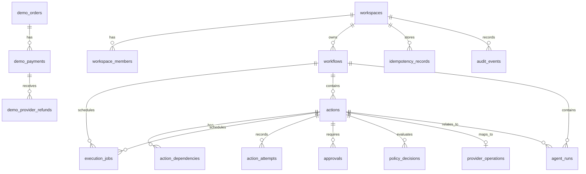

# ActionLedger — DATABASE-SCHEMA.md

**Version:** 0.1  
**Status:** Proposed schema baseline  
**Database:** Supabase PostgreSQL  
**Primary purpose:** Durable workflow state, action identity, approvals, execution coordination, provider reconciliation and audit history.

> This document is the database contract for the first ActionLedger MVP. It is a design specification, not an instruction to run SQL directly in the Supabase SQL editor. The implementation will be delivered as reviewed, ordered migrations after the API and security contracts are agreed.

---

## 1. Database design principles

1. **PostgreSQL is the source of truth.** A process restart must not erase action state, approvals, execution attempts or audit history.
2. **Separate business intent from execution attempts.** One logical action can have multiple attempts. Retrying an action must not create a new logical action.
3. **Make important identities explicit.** Workflows, actions, jobs, attempts, approvals and provider operations each have stable IDs.
4. **Use constraints as well as application validation.** Uniqueness, foreign keys, check constraints and transactions protect against race conditions and programming errors.
5. **Keep an append-only history of important events.** Audit events and execution attempts are records of what happened, not mutable status fields to overwrite.
6. **Do not store secrets or payment-card data.** Provider credentials remain in server-side secret configuration. The demo uses synthetic customer, order and payment data.
7. **Support safe uncertainty.** A timeout does not prove that an external operation failed. Store enough identity and evidence to reconcile it.
8. **Keep the first schema deliberately small.** Avoid premature multi-tenant billing, generic workflow builders, event streaming and unrelated integrations.

## 2. Scope and database schemas

The MVP uses two logical groups of tables:

- **ActionLedger application tables:** workflows, actions, jobs, attempts, approvals, policies, provider references, agent runs and audit events.
- **Simulated commerce provider tables:** demo orders, payments and provider-side refunds. These represent the external system's state and must remain logically separate from ActionLedger's own ledger.

For the initial Supabase implementation, all tables may reside in the `public` schema with clear `demo_` prefixes for simulated-provider data. If a separate PostgreSQL schema for the simulator is introduced later, it must not change the application contracts.

## 3. Entity relationship overview

Relationships are enforced through foreign keys where the referenced records belong to ActionLedger. The simulated provider's tables are deliberately not treated as the authoritative action ledger.

## 4. Common conventions

### 4.1 Identifiers

- Use UUID primary keys, generated by PostgreSQL (`gen_random_uuid()`).
- Use `timestamptz` for all timestamps and store UTC.
- Use `jsonb` only for structured, validated payloads or metadata that genuinely needs flexibility. Do not put the whole relational model into JSON.
- Use `text` plus `CHECK` constraints or PostgreSQL enums consistently for statuses. For the MVP, prefer `text` with checks for statuses that may evolve; use explicit constraints in migrations.
- Money values must be stored as integer minor units (for example, USD cents), together with an ISO 4217 currency code. Do not use floating-point values for money.
- Every workspace-owned row includes `workspace_id` so tenant ownership is explicit.

### 4.2 Time and retention

- `created_at` and `updated_at` are `timestamptz NOT NULL DEFAULT now()` where applicable.
- `updated_at` is maintained by application code or a common database trigger; choose one approach consistently in migrations.
- Audit events and execution attempts are append-only for normal application roles.
- Do not introduce automatic deletion of audit or financial-operation records in the MVP.

### 4.3 Actor representation

An actor is represented by:

- `actor_type`: `user`, `agent` or `system`.
- `actor_id`: UUID or stable system identifier, nullable only for system events that have no separate actor record.
- `actor_label`: optional safe display label for audit readability.

The database must not treat an LLM-generated actor label as an authenticated identity. Authenticated user identity comes from Supabase Auth; agent identity comes from the server-side registered agent configuration.

---

## 4.3 API request idempotency

Action-level idempotency and HTTP request idempotency solve related but different problems:

- `actions.idempotency_key` protects a logical business action such as one refund.
- `idempotency_records` protects a client retry of an HTTP command such as creating a workflow, so the retry does not create a second workflow.

### `idempotency_records`

| Column | Type | Rules / purpose |
|---|---|---|
| `id` | `uuid` | Primary key |
| `workspace_id` | `uuid` | FK to `workspaces.id` |
| `operation_scope` | `text` | Stable operation name, e.g. `POST:/v1/workspaces/{workspaceId}/workflows` |
| `idempotency_key` | `text` | Client-provided opaque key, 16–128 characters |
| `request_fingerprint` | `text` | SHA-256 of canonical validated request data |
| `status` | `text` | `IN_PROGRESS` or `COMPLETED` |
| `resource_type` | `text` | Created resource type, e.g. `workflow` |
| `resource_id` | `uuid` | ID of created resource |
| `response_status` | `integer` | Original successful HTTP status |
| `created_at` | `timestamptz` | Required |
| `updated_at` | `timestamptz` | Required |
| `expires_at` | `timestamptz` | Required; initial retention target 7 days |

**Constraints:** unique (`workspace_id`, `operation_scope`, `idempotency_key`); request fingerprint and key required; `expires_at > created_at`; valid status check. Index expired records for bounded cleanup.

**Transaction rule:** reserve the idempotency key and create the workflow plus planning job in one database transaction. If the same key and fingerprint are replayed, return the original resource. If the same key is replayed with a different fingerprint, return `409 IDEMPOTENCY_KEY_REUSED`. Handle concurrent unique-key races by reading and comparing the winning record after the transaction conflict.

### 4.4 Tenant-consistency constraints

Where a child row stores both `workspace_id` and a parent ID, migrations should enforce tenant consistency with composite uniqueness and foreign keys where practical (for example, `UNIQUE (workspace_id, id)` on parent tables and `FOREIGN KEY (workspace_id, workflow_id) REFERENCES workflows(workspace_id, id)`). Do not rely only on independent foreign keys to prove that a child and its parent belong to the same workspace. Apply the same rule to actions, approvals, jobs, attempts, provider operations, policy decisions and audit references. Where PostgreSQL cannot express a cross-table invariant as a simple constraint, enforce it within a transaction and cover it with negative integration tests.

## 5. Core application tables

## 5.1 `workspaces`

Represents an ActionLedger environment or team boundary. The MVP can create one personal workspace per demo account, but the schema supports membership so approval and audit ownership are explicit.

| Column | Type | Rules / purpose |
|---|---|---|
| `id` | `uuid` | Primary key |
| `name` | `text` | Required, 1–120 characters |
| `slug` | `text` | Required, unique, URL-safe |
| `created_by` | `uuid` | Supabase Auth user ID |
| `created_at` | `timestamptz` | Required |
| `updated_at` | `timestamptz` | Required |

**Indexes / constraints:** unique index on `slug`; index on `created_by`.

## 5.2 `workspace_members`

Maps authenticated users to workspaces and roles.

| Column | Type | Rules / purpose |
|---|---|---|
| `id` | `uuid` | Primary key |
| `workspace_id` | `uuid` | FK to `workspaces.id`, cascade delete only for workspace bootstrap cleanup |
| `user_id` | `uuid` | Supabase Auth user ID |
| `role` | `text` | `owner`, `admin`, `operator` or `viewer` |
| `created_at` | `timestamptz` | Required |

**Constraints:** unique (`workspace_id`, `user_id`); role check constraint.

**Role intent:**

- `owner`: administer workspace and membership.
- `admin`: configure policies and manage operational settings.
- `operator`: review and decide approval requests within permissions.
- `viewer`: read permitted workflow and audit information.

MVP note: self-registration can create a workspace and owner membership. Invitations and advanced role administration are outside the first implementation milestone.

## 5.3 `workflows`

Represents a business-level process, such as handling one customer refund request. A workflow contains one or more actions.

| Column | Type | Rules / purpose |
|---|---|---|
| `id` | `uuid` | Primary key |
| `workspace_id` | `uuid` | FK to `workspaces.id` |
| `workflow_type` | `text` | For MVP: `customer_refund` |
| `status` | `text` | `CREATED`, `RUNNING`, `WAITING_APPROVAL`, `PARTIALLY_COMPLETED`, `SUCCEEDED`, `FAILED`, `NEEDS_ATTENTION`, `CANCELLED` |
| `title` | `text` | Safe human-readable title |
| `input_summary` | `jsonb` | Minimal validated, non-secret request context; no raw untrusted prompt required |
| `requested_by_type` | `text` | `user`, `agent` or `system` |
| `requested_by_id` | `text` | Auth user UUID or registered agent/system ID |
| `correlation_id` | `uuid` | Request trace correlation ID |
| `created_at` | `timestamptz` | Required |
| `updated_at` | `timestamptz` | Required |
| `completed_at` | `timestamptz` | Nullable |

**Indexes:** (`workspace_id`, `created_at DESC`); (`workspace_id`, `status`, `created_at DESC`); unique (`workspace_id`, `correlation_id`) where correlation IDs are assigned once per workflow.

**Rules:** workflow status is a derived/managed summary of child actions. It must not be set by an LLM. The application recomputes it from action states after relevant transitions.

## 5.4 `actions`

Represents one logical consequential operation, such as issuing a refund. An action persists across retries; a retry creates another `action_attempts` row, not another action.

| Column | Type | Rules / purpose |
|---|---|---|
| `id` | `uuid` | Primary key |
| `workspace_id` | `uuid` | FK to `workspaces.id` |
| `workflow_id` | `uuid` | FK to `workflows.id` |
| `action_type` | `text` | Registered action, initially `refund_payment`, `update_order_status`, `send_customer_notification` |
| `target_type` | `text` | For example `order` or `payment` |
| `target_id` | `text` | External/demo resource identifier |
| `status` | `text` | `AWAITING_APPROVAL`, `READY`, `RUNNING`, `RETRY_WAIT`, `OUTCOME_UNKNOWN`, `RECONCILING`, `SUCCEEDED`, `FAILED`, `DENIED`, `CANCELLED` |
| `parameters` | `jsonb` | Validated, normalized operation parameters; never credentials |
| `parameters_hash` | `text` | SHA-256 of canonical normalized parameters |
| `action_version` | `integer` | Starts at 1; increment on any material parameter change |
| `idempotency_key` | `text` | Required caller-supplied or server-generated stable key |
| `request_fingerprint` | `text` | Hash of the normalized request identity and relevant scope |
| `requested_by_type` | `text` | `user`, `agent` or `system` |
| `requested_by_id` | `text` | Authenticated user or registered agent/system ID |
| `requires_approval` | `boolean` | Policy result snapshot |
| `policy_status` | `text` | `ALLOW`, `REQUIRE_APPROVAL` or `DENY` |
| `policy_version` | `text` | Version of policy configuration used |
| `attempt_count` | `integer` | Starts at 0; non-negative |
| `max_attempts` | `integer` | Bounded positive retry limit |
| `next_attempt_at` | `timestamptz` | Nullable; due time for retry |
| `last_error_code` | `text` | Nullable safe machine-readable error |
| `last_error_summary` | `text` | Nullable redacted diagnostic summary |
| `created_at` | `timestamptz` | Required |
| `updated_at` | `timestamptz` | Required |
| `started_at` | `timestamptz` | Nullable |
| `finished_at` | `timestamptz` | Nullable |

**Critical constraints:**

- Unique (`workspace_id`, `idempotency_key`). A replay with the same key and same normalized fingerprint returns the existing logical action; a replay with a different fingerprint returns a conflict.
- `action_version >= 1`.
- `attempt_count >= 0` and `max_attempts >= 1`.
- `parameters_hash` and `request_fingerprint` must be present.
- A database check constrains `status` and `policy_status` to documented values.

**Indexes:** (`workspace_id`, `workflow_id`); (`workspace_id`, `status`, `created_at DESC`); (`status`, `next_attempt_at`) for worker scanning; (`target_type`, `target_id`).

**Immutability rule:** Once an action is approved or has entered execution, its material parameters cannot be edited in place. A changed proposal must create a new action or a new version through a controlled amendment flow, rerun policy evaluation and obtain fresh approval. The MVP should prefer a new action rather than implement complex amendments.

## 5.5 `action_dependencies`

Represents ordering constraints between actions in a workflow.

| Column | Type | Rules / purpose |
|---|---|---|
| `workspace_id` | `uuid` | Required |
| `action_id` | `uuid` | FK to `actions.id` |
| `depends_on_action_id` | `uuid` | FK to `actions.id` |
| `created_at` | `timestamptz` | Required |

**Constraints:** composite primary key (`action_id`, `depends_on_action_id`); no self-dependency; both actions must belong to the same workspace and workflow (enforced in domain transaction or database trigger).

**Rules:** an action is eligible for execution only when all required dependencies are in a state accepted by its dependency policy. The initial refund workflow should use explicit sequential dependencies where the business operation requires them.

## 5.6 `policy_decisions`

Stores each deterministic policy evaluation. A decision is an immutable historical record, not merely a field on the action.

| Column | Type | Rules / purpose |
|---|---|---|
| `id` | `uuid` | Primary key |
| `workspace_id` | `uuid` | FK to workspace |
| `workflow_id` | `uuid` | FK to workflow |
| `action_id` | `uuid` | FK to action |
| `action_version` | `integer` | Version evaluated |
| `parameters_hash` | `text` | Exact evaluated parameter hash |
| `decision` | `text` | `ALLOW`, `REQUIRE_APPROVAL` or `DENY` |
| `policy_version` | `text` | Policy version |
| `reason_codes` | `jsonb` | Array of stable machine-readable reasons |
| `safe_explanation` | `text` | Human-readable explanation, no secrets |
| `evaluated_by` | `text` | Policy engine identifier/version |
| `created_at` | `timestamptz` | Required |

**Indexes:** (`action_id`, `created_at DESC`); (`workspace_id`, `created_at DESC`).

## 5.7 `approvals`

Stores human decisions for actions requiring approval.

| Column | Type | Rules / purpose |
|---|---|---|
| `id` | `uuid` | Primary key |
| `workspace_id` | `uuid` | FK to workspace |
| `action_id` | `uuid` | FK to action |
| `action_version` | `integer` | Exact action version being approved |
| `parameters_hash` | `text` | Must match the action's hash at approval and execution time |
| `status` | `text` | `PENDING`, `APPROVED`, `REJECTED`, `EXPIRED`, `REVOKED` |
| `requested_at` | `timestamptz` | Required |
| `expires_at` | `timestamptz` | Required and after `requested_at` |
| `decided_at` | `timestamptz` | Nullable |
| `decided_by_user_id` | `uuid` | Nullable until decided; authenticated Supabase user ID |
| `decision_reason` | `text` | Optional safe explanation |
| `created_at` | `timestamptz` | Required |
| `updated_at` | `timestamptz` | Required |

**Constraints / indexes:** status check; `expires_at > requested_at`; index on (`workspace_id`, `status`, `expires_at`); index on (`action_id`, `created_at DESC`). A partial unique index should allow at most one pending approval for a given action version.

**Execution rule:** approval is valid only if status is APPROVED, it has not expired, the approver is authorized, and both action version and parameter hash exactly match the current action. The API must not trust an approval flag sent by the browser.

## 5.8 `execution_jobs`

Durable work queue stored in PostgreSQL. A job is a request for the worker to plan a workflow, execute an action or reconcile an action. Every job belongs to a workflow; action-specific jobs also reference an action.

| Column | Type | Rules / purpose |
|---|---|---|
| `id` | `uuid` | Primary key |
| `workspace_id` | `uuid` | FK to workspace |
| `workflow_id` | `uuid` | Required FK to `workflows.id` |
| `action_id` | `uuid` | Nullable FK to `actions.id`; required for `EXECUTE_ACTION` and `RECONCILE_ACTION`, null for `PLAN_WORKFLOW` |
| `job_type` | `text` | `PLAN_WORKFLOW`, `EXECUTE_ACTION` or `RECONCILE_ACTION` |
| `status` | `text` | `QUEUED`, `LEASED`, `COMPLETED`, `DEAD`, `CANCELLED` |
| `available_at` | `timestamptz` | Earliest eligible claim time |
| `lease_owner` | `text` | Nullable worker instance ID |
| `lease_expires_at` | `timestamptz` | Nullable lease expiry |
| `lease_generation` | `bigint` | Starts at 0; incremented on every new claim |
| `claim_count` | `integer` | Non-negative |
| `last_error_code` | `text` | Nullable safe error code |
| `created_at` | `timestamptz` | Required |
| `updated_at` | `timestamptz` | Required |
| `completed_at` | `timestamptz` | Nullable |

**Indexes:** partial index on (`available_at`, `created_at`) for `QUEUED` jobs; partial index on `lease_expires_at` for `LEASED` jobs; (`workflow_id`, `created_at DESC`); (`action_id`, `job_type`, `created_at DESC`) where `action_id` is not null.

**Deduplication:** use a transaction and a suitable partial unique constraint or explicit job-generation key to prevent multiple active execution jobs of the same type for the same action. Reconciliation jobs may be rescheduled after a prior job completes; do not impose a permanent unique (`action_id`, `job_type`) constraint. `PLAN_WORKFLOW` jobs are deduplicated by workflow while one is queued or leased. Add a check constraint requiring `action_id IS NULL` only for `PLAN_WORKFLOW`, and requiring `action_id IS NOT NULL` for the other two job types. Add a partial unique index on `workflow_id` for active `PLAN_WORKFLOW` jobs (`QUEUED` or `LEASED`) so duplicate planning jobs are not created.

**Claiming:** workers claim rows in a short transaction using `FOR UPDATE SKIP LOCKED`, set the lease owner/expiry, increment `lease_generation`, then commit. The external network request happens outside the transaction. Before committing a result, the worker must confirm that its lease generation is still current. A stale worker must not overwrite a newer worker's result.

**Abandoned lease:** an expired lease is not proof that an external call failed. The action must transition into uncertainty/reconciliation handling if execution may have begun.

## 5.9 `action_attempts`

Append-only record of each actual provider execution attempt.

| Column | Type | Rules / purpose |
|---|---|---|
| `id` | `uuid` | Primary key |
| `workspace_id` | `uuid` | FK to workspace |
| `action_id` | `uuid` | FK to action |
| `job_id` | `uuid` | FK to execution job |
| `attempt_number` | `integer` | Starts at 1; unique per action |
| `status` | `text` | `STARTED`, `SUCCEEDED`, `FAILED`, `OUTCOME_UNKNOWN`, `ABANDONED` |
| `provider_name` | `text` | For example `simulated_payment` |
| `provider_operation_key` | `text` | Stable key reused for retries of the same logical operation |
| `provider_reference` | `text` | Nullable external operation reference |
| `request_hash` | `text` | Hash of the request sent to provider |
| `response_summary` | `jsonb` | Sanitized provider response metadata; no secrets or card data |
| `error_code` | `text` | Nullable stable error code |
| `error_summary` | `text` | Nullable sanitized diagnostic |
| `started_at` | `timestamptz` | Required |
| `finished_at` | `timestamptz` | Nullable |

**Constraints:** unique (`action_id`, `attempt_number`); attempt number positive; documented status check.

**Indexes:** (`action_id`, `attempt_number DESC`); (`workspace_id`, `started_at DESC`); unique (`provider_name`, `provider_operation_key`, `attempt_number`) only if provider semantics require it—otherwise enforce provider-operation identity in `provider_operations`.

Attempts are not updated to erase history. A transition from STARTED to a terminal attempt status is allowed through a narrowly controlled update; once terminal, the row is immutable for normal application roles.

## 5.10 `provider_operations`

Maps a logical ActionLedger action to the corresponding external provider operation. It is the primary lookup record for reconciliation.

| Column | Type | Rules / purpose |
|---|---|---|
| `id` | `uuid` | Primary key |
| `workspace_id` | `uuid` | FK to workspace |
| `action_id` | `uuid` | FK to action; one operation per action/provider in MVP |
| `provider_name` | `text` | Registered adapter name |
| `provider_operation_key` | `text` | Stable provider idempotency/lookup key |
| `provider_reference` | `text` | Nullable provider-generated ID |
| `status` | `text` | `NOT_STARTED`, `OUTCOME_UNKNOWN`, `SUCCEEDED`, `FAILED` |
| `last_checked_at` | `timestamptz` | Nullable |
| `safe_result_summary` | `jsonb` | Sanitized verified state |
| `created_at` | `timestamptz` | Required |
| `updated_at` | `timestamptz` | Required |

**Constraints:** unique (`action_id`, `provider_name`); unique (`provider_name`, `provider_operation_key`); documented status check.

The provider operation key must remain stable across retries. If a provider supports idempotency keys, the same key is sent on each retry. If the provider supports lookup by reference/key, reconciliation uses it.

## 5.11 `agent_runs`

Records an agent invocation for observability and debugging. It must not become the source of truth for business execution.

| Column | Type | Rules / purpose |
|---|---|---|
| `id` | `uuid` | Primary key |
| `workspace_id` | `uuid` | FK to workspace |
| `workflow_id` | `uuid` | FK to workflow |
| `action_id` | `uuid` | Nullable FK to action when the run relates to a specific action |
| `agent_role` | `text` | `PLANNER` or `REVIEWER` for MVP |
| `provider_name` | `text` | Model provider or `mock` |
| `model_name` | `text` | Model identifier, nullable for mock |
| `status` | `text` | `STARTED`, `SUCCEEDED`, `FAILED` |
| `input_hash` | `text` | Hash of relevant input, not necessarily raw prompt |
| `output_summary` | `jsonb` | Validated, sanitized structured result summary |
| `token_input` | `integer` | Nullable, non-negative |
| `token_output` | `integer` | Nullable, non-negative |
| `estimated_cost_microunits` | `bigint` | Nullable; integer cost representation in a documented currency/unit |
| `error_code` | `text` | Nullable |
| `started_at` | `timestamptz` | Required |
| `finished_at` | `timestamptz` | Nullable |

**Indexes:** (`workflow_id`, `started_at`); (`action_id`, `started_at`).

Do not store provider API keys, secrets, full unredacted customer messages or sensitive personal data. Persist only what is required to reproduce or explain the agent decision. The MVP may omit token/cost metrics until the selected provider exposes reliable usage data.

## 5.12 `audit_events`

Append-only record of important system events.

| Column | Type | Rules / purpose |
|---|---|---|
| `id` | `uuid` | Primary key |
| `workspace_id` | `uuid` | FK to workspace |
| `workflow_id` | `uuid` | Nullable FK to workflow |
| `action_id` | `uuid` | Nullable FK to action |
| `actor_type` | `text` | `USER`, `AGENT`, `SYSTEM`, `WORKER` |
| `actor_id` | `text` | Nullable stable identity |
| `event_type` | `text` | Stable event name, e.g. `ACTION_CREATED`, `POLICY_DENIED`, `APPROVAL_GRANTED`, `EXECUTION_STARTED`, `PROVIDER_OUTCOME_UNKNOWN`, `RECONCILIATION_SUCCEEDED` |
| `entity_type` | `text` | Entity affected |
| `entity_id` | `uuid` | ID of affected entity |
| `correlation_id` | `uuid` | Trace correlation ID |
| `metadata` | `jsonb` | Sanitized event-specific metadata |
| `occurred_at` | `timestamptz` | Required, UTC |

**Indexes:** (`workspace_id`, `occurred_at DESC`); (`action_id`, `occurred_at`); (`correlation_id`, `occurred_at`).

Normal application roles must have INSERT and SELECT permissions as needed, but no UPDATE or DELETE permission. Audit metadata must not contain secrets, raw authorization headers or payment-card information.

---

## 6. Simulated commerce provider tables

These tables model the external commerce/payment provider. They are used for deterministic demonstrations and failure-injection tests. They are not ActionLedger's own action state.

## 6.1 `demo_orders`

| Column | Type | Rules / purpose |
|---|---|---|
| `id` | `uuid` | Primary key |
| `workspace_id` | `uuid` | FK to workspace |
| `order_number` | `text` | Unique within workspace |
| `customer_reference` | `text` | Synthetic customer ID; no real personal information |
| `status` | `text` | `PAID`, `PARTIALLY_REFUNDED`, `REFUNDED`, `CANCELLED` |
| `total_amount_minor` | `bigint` | Non-negative amount in currency minor units |
| `currency` | `text` | ISO 4217 code, initially `USD` |
| `created_at` | `timestamptz` | Required |
| `updated_at` | `timestamptz` | Required |

**Constraints:** unique (`workspace_id`, `order_number`); valid status; non-negative total.

## 6.2 `demo_payments`

| Column | Type | Rules / purpose |
|---|---|---|
| `id` | `uuid` | Primary key |
| `workspace_id` | `uuid` | FK to workspace |
| `order_id` | `uuid` | FK to `demo_orders.id` |
| `provider_payment_reference` | `text` | Synthetic provider reference, unique within workspace |
| `status` | `text` | `SUCCEEDED`, `PARTIALLY_REFUNDED`, `REFUNDED` |
| `amount_minor` | `bigint` | Non-negative integer amount |
| `currency` | `text` | ISO 4217 code |
| `created_at` | `timestamptz` | Required |
| `updated_at` | `timestamptz` | Required |

**Constraints:** unique (`workspace_id`, `provider_payment_reference`); valid status; one or more payments per order may be supported, but the seed scenario initially uses one payment per order.

## 6.3 `demo_provider_refunds`

Represents the simulated payment provider's own record of a refund. This table is deliberately separate from `actions` and `action_attempts` to reproduce the case where the provider commits the refund but the ActionLedger worker loses the response.

| Column | Type | Rules / purpose |
|---|---|---|
| `id` | `uuid` | Primary key |
| `workspace_id` | `uuid` | FK to workspace |
| `payment_id` | `uuid` | FK to `demo_payments.id` |
| `provider_idempotency_key` | `text` | Required, unique within simulated provider scope |
| `provider_refund_reference` | `text` | Unique synthetic provider refund ID |
| `amount_minor` | `bigint` | Positive integer amount |
| `currency` | `text` | ISO 4217 code |
| `status` | `text` | `SUCCEEDED` or `FAILED` |
| `created_at` | `timestamptz` | Required |

**Constraints:** unique (`workspace_id`, `provider_idempotency_key`); unique (`workspace_id`, `provider_refund_reference`); positive refund amount; currency must match the payment.

The simulated provider must enforce its own idempotency constraint in a transaction. Repeated requests using the same provider key must return the existing refund result instead of creating a second refund.

---

## 7. MVP seed data

The initial demo should seed synthetic data only:

- One demo workspace.
- One owner/operator account (created through Supabase Auth; do not hardcode credentials in migrations).
- Customer reference `CUS-1001`.
- Order number `ORD-1042`.
- One successful payment for USD 500.00 (`50000` minor units).
- No prior refund, unless a specific test fixture requires one.

The default demo policy can require human approval for refunds above a configurable threshold. The initial demonstration may set the threshold to USD 100.00, making a USD 500.00 request require approval. This threshold is a demo configuration, not a universal financial rule.

Seed scripts must be idempotent and must not create duplicate orders or payments when run multiple times.

---

## 8. Transaction boundaries and critical invariants

The following operations must be atomic database transactions.

### 8.1 Create workflow and initial actions

- Insert workflow.
- Insert validated actions.
- Insert dependencies.
- Insert policy decision records.
- Insert approval request or execution job for each action as appropriate.
- Insert audit events.

If any required insert fails, the transaction must roll back. Do not leave an executable action without its corresponding durable execution job.

### 8.2 Approve an action

Within one transaction:

- Lock the approval and action records.
- Verify approver membership and role.
- Verify approval is pending and not expired.
- Verify action version and parameter hash match.
- Record the approval decision.
- Transition the action to READY.
- Insert the execution job.
- Append an audit event.

### 8.3 Claim an execution job

Within a short transaction:

- Select eligible queued work using `FOR UPDATE SKIP LOCKED`.
- Verify action state and dependencies.
- Assign worker lease and increment lease generation.
- Create the attempt record or reserve the attempt identity.
- Transition the action to RUNNING.
- Commit before making external network requests.

The implementation must define precisely when an attempt is considered started and ensure a crash between claim and provider call is safely recoverable.

### 8.4 Record a provider outcome

- Confirm the worker still owns the current lease generation.
- Store sanitized attempt result.
- Update provider operation state.
- Update action state.
- Schedule retry/reconciliation job if needed.
- Append audit event.

A stale worker must not overwrite a newer execution/reconciliation result.

### 8.5 Simulate successful provider operation with lost response

The simulator must:

1. Receive a refund request with a stable provider idempotency key.
2. Persist one provider refund under a unique key.
3. Update simulated payment/refund state atomically.
4. Simulate a network/transport failure after the provider transaction commits but before the worker receives the response.
5. Cause ActionLedger to record `OUTCOME_UNKNOWN`.
6. Reconcile by querying the simulator using the provider idempotency key or provider reference.
7. Mark the ActionLedger action `SUCCEEDED` only after confirming the provider refund exists and matches the requested amount/currency.
8. Assert that only one provider refund row exists.

This is the signature reliability demonstration for the MVP.

---

## 9. Row-level security and access control

Enable Row Level Security on all workspace-owned application and demo tables exposed through Supabase APIs.

Minimum rules:

- A user can read workspace data only if they are a member of that workspace.
- A `viewer` cannot approve or mutate actions.
- Only an authorized `operator`, `admin` or `owner` can approve actions, subject to policy.
- Only `owner`/`admin` can manage workspace membership and policies.
- Browser clients must never receive the Supabase service-role key.
- The backend must validate the Supabase access token and enforce workspace membership for every operation.
- A server-side worker must use only server-held credentials and explicitly scope every query by workspace. Since a Supabase service-role key bypasses RLS, its use must be tightly confined to the backend/worker and never treated as a replacement for application authorization.
- Audit events and completed execution attempts must not be editable/deletable by ordinary application roles.

Implementation note: before deployment, verify the exact RLS claims and connection model used by the Fastify API and worker. Do not assume a direct PostgreSQL connection automatically carries the browser user's Supabase JWT claims.

---

## 10. Data security and privacy

- Use synthetic data in the public demo.
- Never store card numbers, CVVs, bank credentials or payment-provider secrets.
- Store provider credentials only in server-side environment secrets.
- Redact authorization headers, access tokens, API keys and sensitive customer fields from logs and `jsonb` metadata.
- Store only the minimum customer information needed for the workflow.
- Do not persist raw LLM prompts by default; store hashes and sanitized structured summaries where practical.
- Apply input length limits to JSON payloads and text summaries.
- Use explicit retention/cleanup procedures for temporary media or uploaded files if such features are added later.

---

## 11. Migration order

Create ordered SQL migrations. Suggested order:

1. `0001_create_workspaces_and_members.sql`
2. `0002_create_workflows_and_actions.sql`
3. `0003_create_policy_decisions_and_approvals.sql`
4. `0004_create_execution_jobs_and_attempts.sql`
5. `0005_create_provider_operations_and_audit_events.sql`
6. `0006_create_agent_runs.sql`
7. `0007_create_demo_commerce_tables.sql`
8. `0008_add_indexes_constraints_and_rls.sql`
9. `0009_create_idempotency_records_and_planning_jobs.sql`
10. `0010_seed_demo_data.sql` (or a separately versioned seed script)

Migrations must be repeatable in a clean local/test database and reviewed before applying to the hosted Supabase project. Avoid modifying an already-applied migration; add a new migration for subsequent changes.

---

## 12. Schema-level acceptance criteria

The database design is correctly implemented when automated tests establish all of the following:

1. Every workflow and action belongs to a workspace.
2. Actions cannot reference a workflow from a different workspace.
3. A workspace cannot create two actions with the same idempotency key.
4. Reusing a key with different normalized parameters is rejected by application logic.
5. Multiple attempts can exist for one action, but attempt numbers cannot repeat.
6. Only one active execution job of a given type can be claimed for an action at a time.
7. Two workers cannot successfully own the same lease generation.
8. An action requiring approval cannot become executable until a valid approval is recorded.
9. Approval is invalid if action version or parameter hash changes.
10. Audit events are append-only for ordinary application roles.
11. Provider idempotency prevents duplicate rows in `demo_provider_refunds`.
12. A successful simulated refund with a lost response can be reconciled without a second refund.
13. All tenant-owned reads and writes enforce workspace boundaries.
14. The system can reconstruct the complete action history from persisted records after an application restart.

---

## 13. Explicitly deferred database features

Do not implement these in the initial MVP unless a concrete requirement emerges:

- Billing, subscription and invoice tables.
- Organization invitation workflows.
- Advanced policy editor/version management UI.
- Generic arbitrary workflow builder.
- Multi-region replication.
- Event sourcing for every database entity.
- Redis/Kafka infrastructure.
- Full message-delivery/outbox platform for every notification type.
- Real customer payment data.
- Complex multi-provider financial reconciliation.

The first objective is one trustworthy refund workflow with reproducible failure and recovery behaviour.

---

## 14. Next document

After reviewing this schema, prepare `API-SPECIFICATION.md` covering:

- Workflow creation and retrieval.
- Action proposal submission.
- Policy evaluation results.
- Approval listing, approval and rejection.
- Action status and execution history.
- Worker-only claim/heartbeat/result operations (internal contract; not exposed as public user endpoints).
- Reconciliation request/status.
- Authentication, workspace authorization, idempotency and standard error responses.

Do not generate application code solely from this schema document. The schema must be reconciled with the API, security design and implementation plan first.

---

## 15. API alignment amendment (v0.1)

The API specification uses a durable `PLAN_WORKFLOW` job when a workflow is created. To support that flow, `execution_jobs` includes `workflow_id` and permits a null `action_id` only for `PLAN_WORKFLOW`. The schema also includes `idempotency_records` for HTTP command replay protection. These amendments are part of this consolidated schema and must be reflected in the initial migrations.

The first implementation should create a workflow and its `PLAN_WORKFLOW` job in one transaction. The worker runs the mock or configured Planner and Reviewer, validates the proposal, records policy decisions, creates actions/approvals and execution jobs, and updates workflow state. Do not call an LLM synchronously inside the workflow-creation HTTP request.
