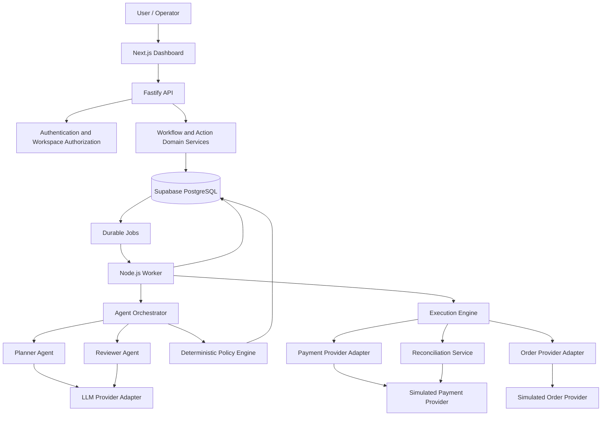

# ActionLedger — System Architecture

**Version:** 0.1  
**Status:** Proposed architecture baseline  
**Architecture style:** TypeScript modular monolith + independent worker  
**Persistence:** Supabase PostgreSQL

## 1. Architecture overview

ActionLedger separates AI reasoning from authorization and execution. AI components generate structured proposals; deterministic domain services validate and authorize them; a persistent worker executes permitted actions through provider adapters; reconciliation verifies external outcomes.

PostgreSQL is the source of truth for workflows, actions, approvals, jobs, attempts, provider operation references and audit history.

## 2. Logical components



This is a logical diagram, not a requirement that every box be a separately deployed service.

## 3. Deployment shape

### Web

- Next.js + React + TypeScript.
- Hosted on Vercel for the portfolio demo.
- Displays workflows, actions, approvals and audit history.
- Never calls a payment provider directly.
- Never contains a Supabase service-role key or LLM secret.

### API

- Fastify + TypeScript.
- Independently deployable Node.js application.
- Authenticates users, validates inputs and enforces workspace membership.
- Creates workflows and durable planning jobs.
- Handles approval commands and read APIs.
- Does not keep an HTTP request open while an LLM or provider workflow runs.

### Worker

- Separate, persistent Node.js process.
- Claims PostgreSQL jobs using short transactions and `FOR UPDATE SKIP LOCKED`.
- Uses lease ownership/generation to prevent stale workers from committing results.
- Executes provider requests outside database locks.
- Handles planning, execution and reconciliation job types.
- Can be restarted without losing persisted work.

### Database

- Supabase PostgreSQL.
- Authoritative store for durable workflow and action state.
- Browser access is limited by RLS and user permissions.
- API and worker access is server-side and explicitly workspace-scoped.

### Local development constraints

The developer's laptop has 4 GB RAM. Do not require local Ollama models, a full local Supabase Docker stack or multiple heavyweight containers. Start with the hosted Supabase development project, a local API and worker, and mocked LLMs. Run heavier integration tests in GitHub Actions or a suitably provisioned environment.

## 4. Repository boundaries

```text
actionledger/
  apps/
    web/                 # Next.js dashboard
    api/                 # Fastify API
    worker/              # Persistent job worker
  packages/
    contracts/           # Shared Zod schemas and DTOs
    domain/              # Workflow/action domain types and state rules
    database/            # Database access and migrations
    policies/            # Deterministic authorization
    execution/           # Job processing and action execution
    providers/           # Payment/order/LLM provider interfaces
    agents/              # Planner and Reviewer orchestration
  docs/                  # PRD, architecture, schema, API, security, tests, plan
  supabase/migrations/   # Ordered SQL migrations
  package.json
  pnpm-workspace.yaml
  tsconfig.base.json
```

Keep the initial deployment a modular monolith. Packages are code boundaries, not necessarily separately deployed services.

## 5. Core request lifecycle

1. An authenticated user submits a customer request with an HTTP idempotency key.
2. The API validates the request and workspace membership.
3. A transaction creates an idempotency record, workflow and `PLAN_WORKFLOW` job.
4. The API returns `202 Accepted` with the workflow ID.
5. The worker claims the planning job.
6. The Planner creates a structured proposal; the Reviewer produces advisory findings.
7. The worker validates action schemas and runs deterministic policies.
8. A transaction stores actions, policy decisions, approval requests and eligible execution jobs.
9. Required actions wait for an authorized human. Directly allowed actions become executable.
10. The worker claims action jobs and executes registered provider operations.
11. The system records results, schedules retry or reconciliation, and appends audit events.
12. The dashboard reads persisted state and presents the workflow timeline.

## 6. Execution state and durable jobs

Action and job state are separate:

- An **action** is the logical business operation and survives retries.
- An **execution job** is a unit of work that can be claimed and rescheduled.
- An **attempt** records one provider execution attempt.
- A **provider operation** maps the logical action to an external operation identity used for lookup/reconciliation.

### Action state machine

ActionLedger preserves the approved action states and their legal transitions:

- `AWAITING_APPROVAL` may move to `READY`, `DENIED`, or `CANCELLED`.
- `READY` may move to `RUNNING` or `CANCELLED`.
- `RUNNING` may move to `SUCCEEDED`, `RETRY_WAIT`, `OUTCOME_UNKNOWN`, or `FAILED`.
- `RETRY_WAIT` may move to `READY` or `CANCELLED`.
- `OUTCOME_UNKNOWN` may move only to `RECONCILING`.
- `RECONCILING` may move to `SUCCEEDED`, `READY`, `FAILED`, or `OUTCOME_UNKNOWN`.

`SUCCEEDED`, `FAILED`, `DENIED`, and `CANCELLED` are terminal states with no outgoing transitions.

Workflow status is derived from child action states in this precedence:

1. Empty workflow: `CREATED`.
2. Any `OUTCOME_UNKNOWN` action: `NEEDS_ATTENTION`.
3. Any `AWAITING_APPROVAL` action: `WAITING_APPROVAL`.
4. Active execution, retry, or reconciliation (`RUNNING`, `READY`, `RETRY_WAIT`, `RECONCILING`): `RUNNING`.
5. All actions `SUCCEEDED`: `SUCCEEDED`.
6. Successful actions mixed with failed, denied, or cancelled terminal actions: `PARTIALLY_COMPLETED`.
7. All actions `CANCELLED`: `CANCELLED`.
8. Other fully terminal unsuccessful workflows: `FAILED`.

Initial job types:

- `PLAN_WORKFLOW`
- `EXECUTE_ACTION`
- `RECONCILE_ACTION`

The worker claims jobs in short DB transactions. The provider call occurs after commit. Before writing results, the worker must verify lease generation and ownership. An expired lease after a provider call may have started must trigger uncertainty handling, not an assumption of failure.

## 7. Agent architecture

### Planner

- Receives a validated workflow input and bounded read-only context.
- Returns a typed list of proposed actions and a concise rationale.
- Has no payment credentials and no direct write access to business tables.
- Cannot set policy outcomes or action execution status.

### Reviewer

- Receives the proposed action plan and allowed context.
- Returns structured findings such as `PASS`, `NEEDS_CHANGES` or `ESCALATE` plus issue codes.
- Is advisory; it cannot approve or execute an action.

### Policy engine

- Deterministic TypeScript code.
- Validates role, action type, resource, amount, approval threshold and business invariants.
- Returns `ALLOW`, `REQUIRE_APPROVAL` or `DENY` with stable reason codes.

### Operations

The worker and execution engine carry out authorized actions. Do not create a third unrestricted LLM agent with direct provider credentials. If an Operations Agent is added later, it may request status or execution through controlled tools only.

## 8. Provider interfaces

Use narrow interfaces and typed results. Initial providers:

- `SimulatedPaymentProvider`
- `SimulatedOrderProvider`
- `MockLLMProvider`

Later adapters can include one real LLM provider and MCP-facing tool contracts. Provider adapters do not authorize actions. They accept an already-authorized operation and return explicit outcomes: success, definitive failure, retryable failure or unknown outcome.

## 9. Reliability principles

- Use integer minor units for money.
- Use canonical parameter serialization and SHA-256 fingerprints.
- Keep stable ActionLedger and provider idempotency identities across retries.
- Enforce uniqueness in PostgreSQL, not only in application memory.
- Do not hold DB locks during network calls.
- Use bounded exponential backoff with jitter only for safe retry classes.
- Verify actual provider state before marking success.
- Reconcile an uncertain operation before retrying it.
- Do not claim exactly-once semantics across arbitrary external APIs.

## 10. Technology choices

| Area | Choice |
|---|---|
| Language | TypeScript with strict compiler options |
| Runtime | Node.js LTS, pinned in repository config |
| Package manager | pnpm workspaces |
| Backend | Fastify |
| Frontend | Next.js + React |
| Database | Supabase PostgreSQL |
| Auth | Supabase Auth |
| Validation | Zod |
| Testing | Vitest + Playwright |
| AI | Provider abstraction, mock first |
| CI | GitHub Actions |
| Hosting | Vercel for web; independent Node.js API/worker host selected later |

Avoid n8n as a runtime dependency; an n8n integration can be a future adapter.

## 11. Architecture decisions

- Modular monolith over microservices.
- PostgreSQL-backed job coordination for MVP; no Redis/Kafka initially.
- Separate worker process for durable background work.
- Mock agents and simulated providers first.
- Deterministic policy engine independent of agent outputs.
- Supabase for managed database/auth; Vercel only for web hosting.
- Public demo uses synthetic data and no real payment processing.

## 12. Known constraints and open items

- Supabase free projects may pause when inactive; the demo needs a wake-up/restart expectation.
- Vercel functions are not the persistent worker.
- A separate Node.js host may be required for a public always-on demo; select one after the local worker is functional and free-tier suitability is confirmed.
- The first demo uses a simulated payment provider. Any real payment adapter requires a separate security, legal and operational review.
- Cross-workspace composite foreign keys and RLS policies must be implemented and tested, not assumed from application types alone.
